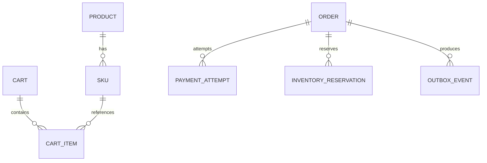

# API／イベント／ER 詳細設計（サービス境界）

> 全て目標設計。公開サイトから確証のない内部構成を推定しない。機械可読ファイル：`reference-models/commerce_openapi.yaml` と `reference-models/engineering_cases.json`。

## OpenAPI セマンティクス

- Idempotency-Key = UUID、ユーザーと operation にスコープした有効期限付き重複制御。異なる payload を同じキーで送れば 409。
- POST checkout の `202 Accepted` は処理中、`201 Created` は生成確定。失敗や不明支払を 200 success としない。
- `GET /v1/checkouts/{id}` は authoritative status。客户端自动重试 POST checkout 禁止、先 GET または same key replay。
- `Authorization` は server-only permission 判定、LIFF token client 端の権限の代替ではない。
- エラーレスポンスは problem+json。traceId、code、retryable により分岐させる。

## Event / Outbox

| Event | producer | consumer | once strategy | compensation |
|---|---|---|---|---|
| OrderRequested | Order | Inventory | event ID dedup | release pending reserve |
| StockReserved | Inventory | Order | reservation ID uniqueness | stock release |
| PaymentAuthorized | Payment Adapter | Order | provider ref dedup | reverse/refund per provider |
| PaymentUnknown | Payment Adapter | Reconciliation | reconcile polling | never charge twice |
| OrderConfirmed | Order | Notification | outbox+consumer dedup | notification retry only |
| PaymentReconciled | Payment Adapter | Order | version check | settle/compensate accordingly |

Event header `{eventId, schemaVersion, correlationId, causationId, traceparent, occurredAt, aggregateId}`。PII を Broker payload に流さない。Producer は order aggregate と Outbox を同一 DB transaction で commit。Consumer は Inbox key にて重複処理を除去し、順序保証が必要な aggregate は version で制御。

## ER（概念、サービスごとの schema 所有）

## Threat model

- spoofed LIFF ID token → issuer/audience/signature/nonce verify。
- webhook forgery/replay → HMAC verify、timestamp window、unique provider event ID。
- cross-user order lookup → owner authorization, deny & log。
- price tampering → authoritative server price, not client subtotal。
- double-commit race → optimistic version / unique key / serializable constraints as needed。
- payment unknown → nonterminal result with reconcile, no blind retry。
- secrets and card data → secret manager, provider tokenization, never logs/UI/cases。
