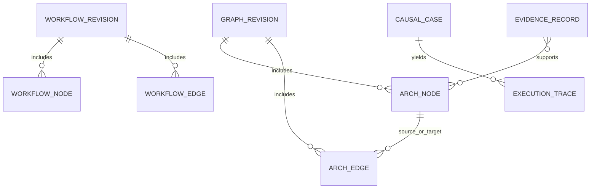

# Canonical Data Contracts（最终契约）

## Architecture Node / Edge

`assets/models/architecture.json` 使用 schema `gemarc.architecture/v1`。Node: `id`, `name`, `kind`, `zone`, `parentId`, `verification`, `evidenceIds`, `properties`。Edge: `id`, `sourceId`, `targetId`, `type`, `directed`, `condition`, `weight`, `evidenceIds`, `verification`。多重边使用独立 Edge ID；`sourceId`/`targetId` 不得引用缺失 Node。证据引用指向 Evidence Ledger，不支持隐式编造证据。

## Workflow

`assets/models/workflow.json`: `identity / semantics / presentation / provenance / validation`，`gemarc.workflow/v1`。语义与画布坐标分离；Port 对端必须存在；没有声明的 Guard 不会执行。当前导出仅保存约定的语义/画布字段，其他供应商扩展不能保证 round-trip。

## Causal Flow

`assets/models/causal_flows.json`：`gemarc.causal-flow/v2`。

```json
{
  "id": "checkout",
  "entry": "begin",
  "maxSteps": 24,
  "steps": [
    {"id": "check-a", "nodeId":"inventory", "label":"库存余量可信",
      "decision":{"field":"aOk","operator":"eq","value":true},
      "yes":"check-b", "no":"abort-a", "animation":"branch"}
  ]
}
```

Guard 限 `eq/ne/gt/gte/lt/lte/in`，任意字符串不能被执行。`patch` 是显式状态修改。每个步骤记录 `sequence`, `ruleId`, `nodeId`, `branch`, `delta`, `state`。同时具有 `terminal` 和可选 `error`；budget exhausted 与 invalid 不得伪装成业务成功。

## Causal Case

`assets/models/causal_cases.json`：每个 Case 含 ID、Flow ID、category、severity、expectedTerminal、inputs、requirements IDs、design IDs、precondition、assertion、compensation expectation，验证等级始终 Hypothetical。

144 Cases 采用相同 16 流程进行**可重复的条件求值**。CASE 状态是开发/测试数据，不是 Feliture 后端业务证据。

## Physical deployment / ER

目前不存在可核验的生产数据库 DDL，因此 **不得声称已有真实 ER**。建议中的物理存储表（尚未实现）分别为 `graph_revision`, `arch_node`, `arch_edge`, `evidence_record`, `workflow_revision`, `causal_case`, `execution_trace`, `approval_log`。基础约束包括 PK stableId/revision、FK edge endpoint 和 Evidence 引用、不可修改的审计序列、租户隔离。



**该 ER 仅是 Designed schema，而不是已存在的 DB 实例。**
