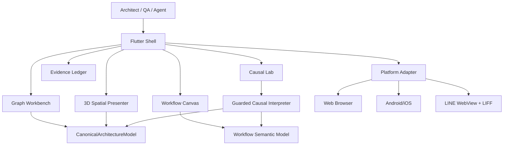
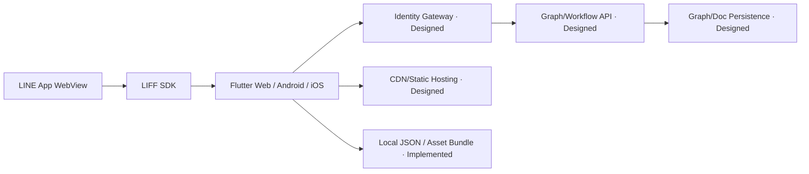
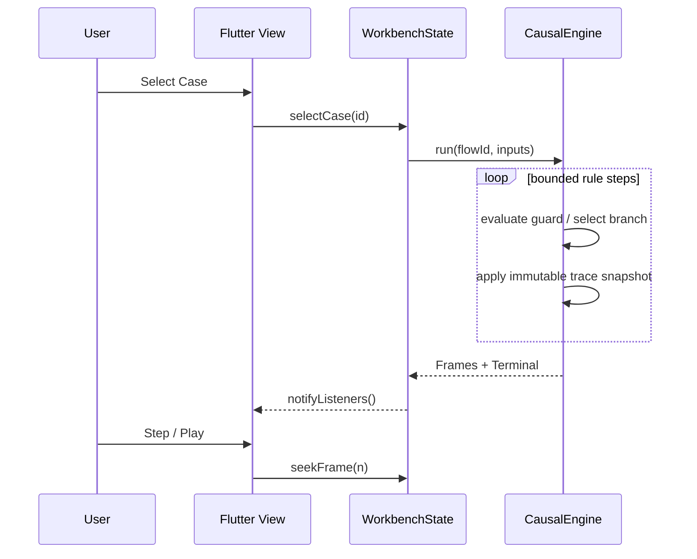

> 文書種別: IPA 共通フレーム2013・非機能要求グレード2018 を参照した独自成果物。IPA の審査・認証済みではない。
> 対象: GemArc 5D Flutter Workbench。Feliture の公開ページはサンプル入力であり、非公開システム構成の証拠ではない。
> 基準日: 2026-10-17。仕様の実装状態は `../quality/VERIFICATION.md` を正とする。

# 基本設計書（System / Basic Design）

## 1. 論理構成

## 2. 責務境界
- `core/models.dart`: 事実等級と不変識別子、Graph/Workflow JSON 整合性。
- `core/causal_engine.dart`: 外部副作用のない状態遷移・分岐・差分。
- `core/workbench_state.dart`: 共有状態と選択コンテキスト。
- `features/architecture`: 2D Node/Edge Explorer と 3D 空間投影。
- `features/workflow`: ノードとポートの視覚編集、導入/導出。
- `features/causal`: ケース選択と因果再生・正常ベースラインとの差分。
- `bridges`: LIFF SDK を Web 境界に隔離。

## 3. 3D 空間の意味
System は Building、層は Floor（体験、業務、データ）、Domain は Room、Graph Node は Gem、Edge は配線として表示する。Room/Floor は表示上の仮想編成で、実際の物理施設、VM、ネットワーク機器と混同しない。Gem を UI ボタンや一般的なチャートに利用しない。

## 4. 配置構成（提案）

## 5. UX 動線
グローバルナビ → Graph 2D / 3D / Canvas / Causal / Evidence。Node と Edge はそれぞれクリック可能な Inspector を持つ。ケース再生は同じ Node ID を用いる。拡大・パンで連線のタッチ領域は視覚線より広く設定する。

## 6. 重要シーケンス

## 7. セキュリティ境界
Web JS が LIFF 初期化結果のみを Flutter に返す。アクセストークン、ユーザー識別子、プロファイル、決済秘密をシミュレーションモデルに流さない。認可判断はサーバーで実施する（サーバー実装は現成果物の対象外）。
