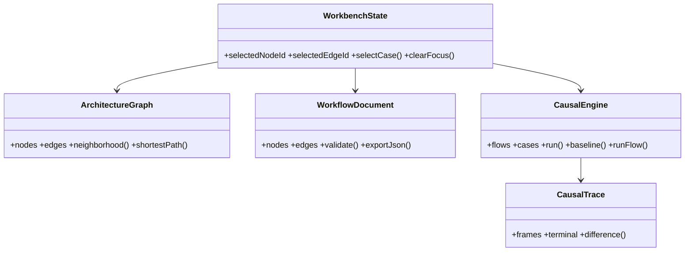

> 文書種別: IPA 共通フレーム2013・非機能要求グレード2018 を参照した独自成果物。IPA の審査・認証済みではない。
> 対象: GemArc 5D Flutter Workbench。Feliture の公開ページはサンプル入力であり、非公開システム構成の証拠ではない。
> 基準日: 2026-10-17。仕様の実装状態は `../quality/VERIFICATION.md` を正とする。

# 詳細設計書（Software Detailed Design）

## 1. データ型と契約
| 型 | キー | 必須 | 制約 |
|---|---|---|---|
| ArchitectureNode | id/name/kind/verification/evidenceIds | Yes | ID 重複不可、証拠等級は列挙型 |
| ArchitectureEdge | id/sourceId/targetId/type/directed | Yes | 有効 Node ID 必須。多重辺可 |
| WorkflowNode | id/type/input/output/config | Yes | port 名は文字列集合 |
| WorkflowEdge | id/sourceId/targetId/sourcePort/targetPort | Yes | 既存ノードのポートを参照 |
| CausalRule | id/nodeId/decision/patch/next | Yes | 停止条件、next 参照整合 |
| CausalCase | id/flowId/inputs/expectedTerminal | Yes | 仮説の検証等級を明記 |
| CausalFrame | sequence/ruleId/nodeId/branch/delta/state | Yes | 0 起点、順序単調増加 |

## 2. 因果遷移アルゴリズム
1. `entry` から開始しステップ予算を確認する。
2. `decision` が存在すれば `field/operator/value` を純粋関数で評価する（eq/ne/gt/gte/lt/lte/in のみ許可）。
3. `yes/no` を選択し、`patch` を適用する。`before/after` を差分に残す。
4. `Frame` に採択分岐、Graph Node ID、描画用 animation を保存する。
5. `next == null` で終了。未知ルール、未知演算子、予算超過は `invalid`/`budget-exceeded` として拒否する。
6. 同一フローにすべて正常な変数を与えたベースラインと実行最終状態を比較し、差異を表示する。

- 擬似コード: `while(next != null && steps < maxSteps) { guard; next; patch; appendFrame; }`
- 時間経過は UI の再生であり実取引の待ち時間ではない。遅延・実運用故障統計を捏造しない。
- 異常後の補償は `compensate -> can-recover -> recovered/end-failed` の経路で明示する。
- 防止すべき副作用: 自動購入、注文、決済、LINE 本番通知、データ削除。

## 3. Focus Engine
選択 ID → Graph neighborhood(depth <= 4) → related node set → canvas opacity transform。Edge 選択は両端を起点とする。退避は View-Only、Graph の位置と意味は不変。Focus lock/clear/depth を操作可能。

## 4. 3D Projection 詳細
`u = x*cos(theta)-y*sin(theta)`、`v=(x*sin(theta)+y*cos(theta))*.43 - z`。Floor Z と爆発距離を Renderer 内で組み立てる。Node を型別の形状・色で描き、Graph ID を保持する。Click は投影した点とタップの距離、Edge は線分距離を 12px 以内で判断する。これは **Flutter CustomPainter によるソフトウェア投影** であり、透視カメラ・遮蔽・メッシュなどのフル 3D エンジンではない。真の立体 Engine への差し替えは Designed。

## 5. Workflow 編集
- 意味論: `semantics.nodes[]`, `semantics.edges[]`。
- 表示: `presentation.nodes[]` の座標はシミュレーション意味に非影響。
- 端点検証: source/outputPort、target/inputPort、ID 一意。
- 導入: JSON 解析→検証→置換。失敗時に旧ワークフローは破壊されない。
- 導出: UTF-8 JSON をクリップボードへ格納。
- Port 型、正式 BPMN ゲートウェイ互換などは別契約で Designed。条件文字列は表示・保存のみで実行不可。

## 6. LIFF Web Bridge
`line_bridge.js` が SDK 読込、`liff.init(liffId)`、`isInClient()/isLoggedIn()` の真偽を返す。Dart 側は条件付き import により Native Stub へ切替。アクセストークンは Dart 側へ戻さない。ログイン強制・ユーザーデータ処理は実装せず、同意・本人確認・サーバー側認証設計の審査を必須とする。

## 7. クラス関係

## 8. 実装境界
実装済みコードと提案 API（GraphQL/REST, MCP, 認可 Server, IndexedDB, 真 3D, BPMN import）の間に公開済み互換性を主張しない。`docs/quality/VERIFICATION.md` の状態表を参照。
