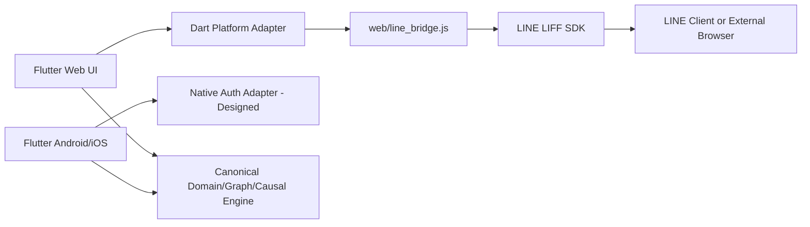

# LINE MINI App / LIFF 跨端接入设计（日本市场）

**定义**：LINE MINI App 是在 LINE WebView 中运行的 Web 应用；Flutter 的 Android/iOS 构建产物本身不能作为 LINE MINI App 上传。采用 Flutter Web + LIFF JavaScript SDK，在编译时传入公开的 LIFF ID；不得把 Channel Secret、私钥或用户 Access Token 编译到前端。

## 分层

## 运行契约

| Case ID | 触发条件 | 响应 |
|---|---|---|
| LIFF-001 | SDK 加载成功、`liff.init` 成功 | 允许只读工作台，不自动获取用户 Profile |
| LIFF-002 | LIFF ID 未配置 | 明确显示初始化未配置；其余产品功能继续运行 |
| LIFF-003 | SDK 网络加载失败 | 降级普通 Flutter Web 模式，不重复重定向 |
| LIFF-004 | 外部 Chrome/Safari 访问 | 不调用要求 LINE Client 的 API；访客仍可打开非敏感页面 |
| LIFF-005 | 用户尚未登录 | 仅在真正需要授权时提示；避免自动跳转循环 |
| LIFF-006 | 未授权或撤销授权 | 禁止访问任何需授权数据，最小收集 |
| LIFF-007 | LIFF SDK 版本差异 | 记录兼容性矩阵，回归 iOS WKWebView 与 Android WebView |
| LIFF-008 | 返回、最小化、关闭 | LINE Header 主导；Flutter Navigator 与 LIFF 路由冲突需实机验证 |
| LIFF-009 | 隐私文档、提供方信息缺失 | 阻止发布申请 |
| LIFF-010 | 商品/内容被平台政策排除 | 阻止 LINE 渠道发布，不影响一般 Web/App 架构研究 |
| LIFF-011 | 访问过量 API/性能压测 | 不向正式 LINE 平台发送压力流量，改用 Mock |
| LIFF-012 | 订单/支付类审核 | 准备模拟账户、商品/订单资料和测试场景供审核 |

## 服务端设计（尚未实现）

1. LINE ID Token / Access Token 应由服务器验证签名、受众、有效期与主体；客户端 UI 状态不能决定业务权限。
2. 后端 API 使用短期会话标识、CSRF/Replay 防护、幂等键和最小 RBAC；强制 HTTPS。
3. Service Messages 必须由服务器按照 LINE 官方限制发送，严格禁止通过客户端模拟业务操作触达生产账户。
4. 对每项数据说明处理目的、删除与撤销授权渠道、日志脱敏和保存期限。

## 政策门槛

需要审查实际商品分类和页面呈现。日本 LINE MINI App Policy 对成人相关商品广告及色情、性内容有明确限制；平台可因业务类别和内容不符合标准而拒绝、撤销认证或下架。**普通服装/内衣与成人性商品的界限不能仅由代码推断；需要将商品详情、广告素材、支付方式及业务模型逐项交由政策/法务判断**。

## 官方依据（2026-10-17 查询）

- https://developers.line.biz/en/docs/line-mini-app/develop/web-to-mini-app/
- https://developers.line.biz/en/docs/line-mini-app/discover/specifications/
- https://developers.line.biz/en/docs/line-mini-app/develop/external-browser/
- https://developers.line.biz/en/docs/line-mini-app/submit/submission-guide/
- https://developers.line.biz/en/docs/line-mini-app/development-guidelines/
- https://terms2.line.me/LINE_MINI_App?lang=en

## 发布门槛

`Channel Created` → `HTTPS Endpoint verified` → `Privacy / Business eligibility` → `WKWebView & Android WebView tested` → `External browser tested` → `Case evidence submitted` → `LINE review` → `Verified publishing`。以上均尚未在现有环境实机验证。
