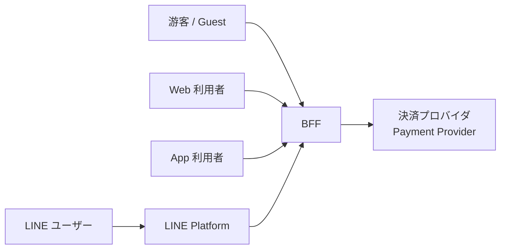
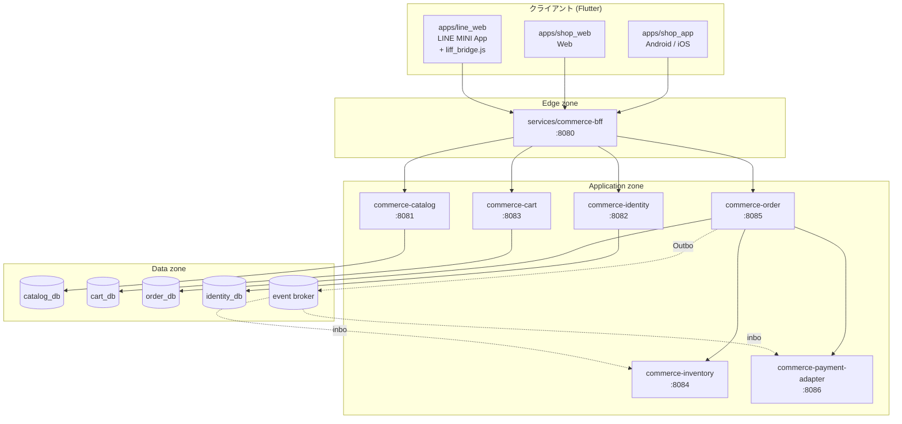
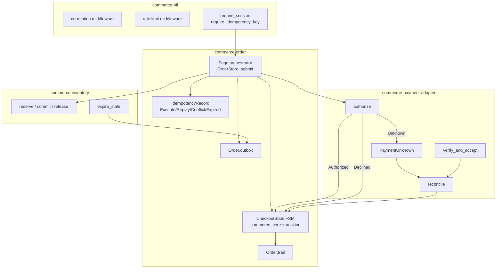
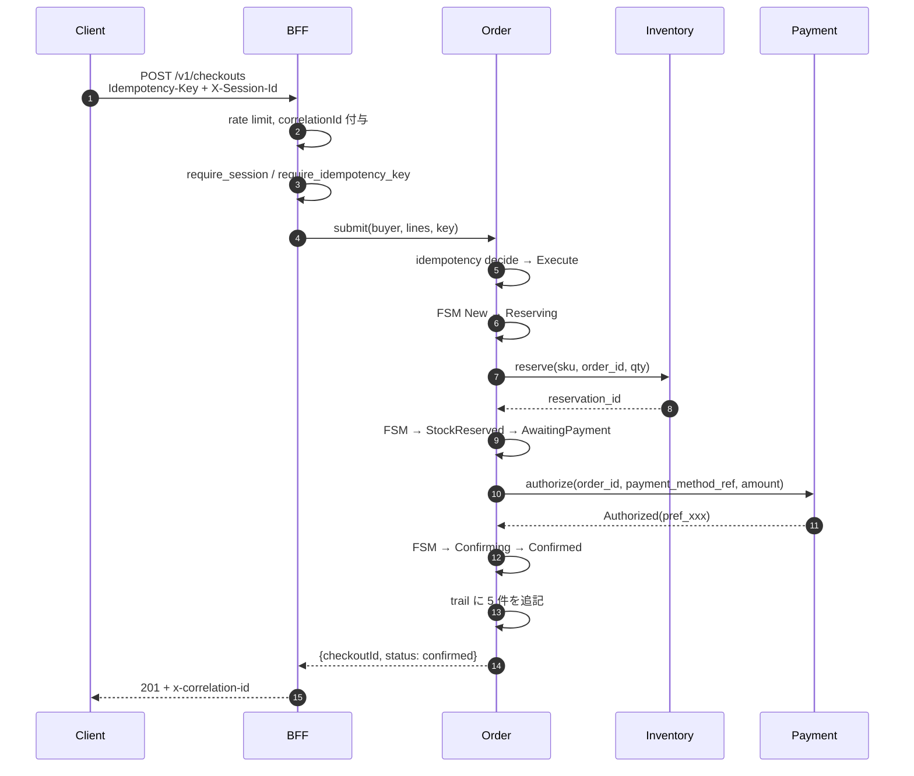
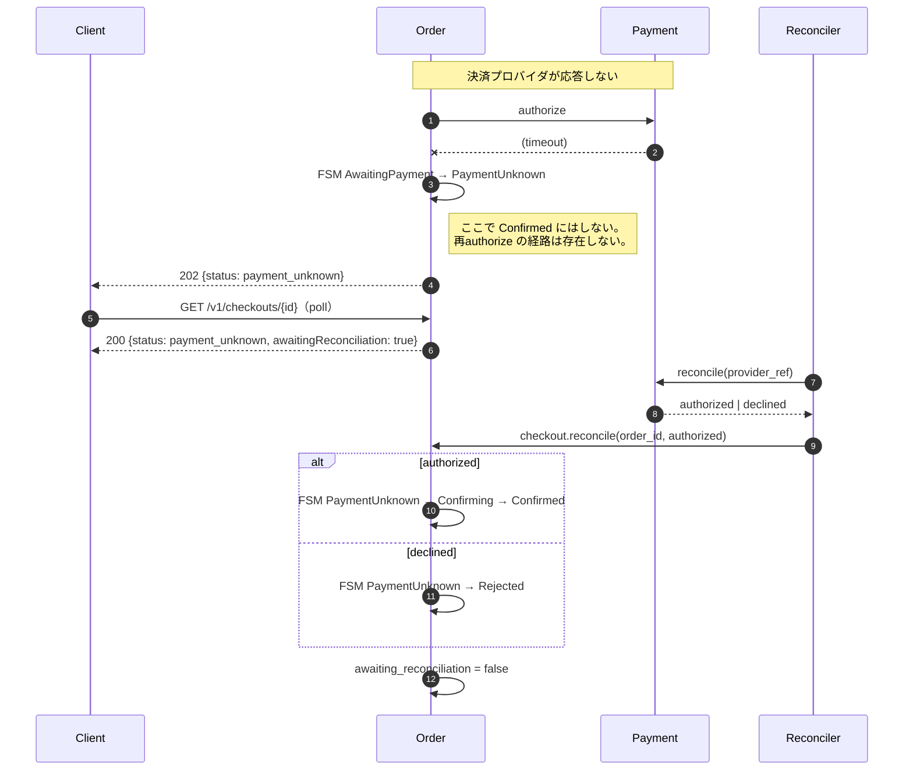
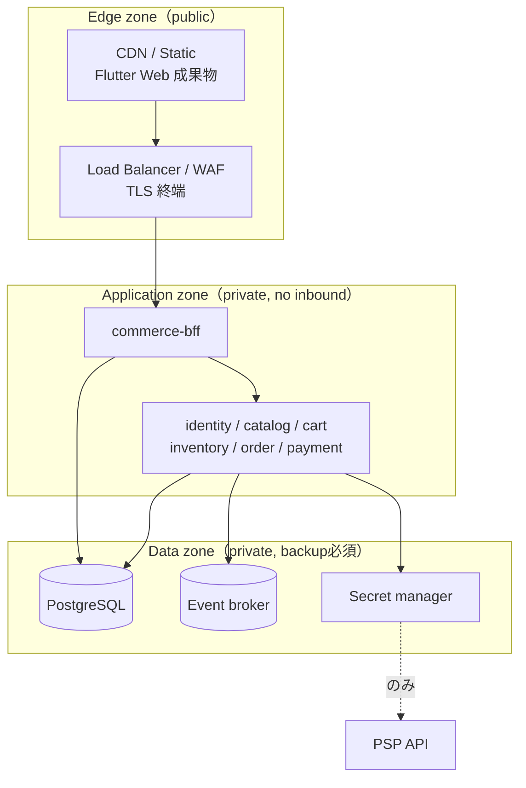

> 文書種別: IPA 共通フレーム2013 を参照した独自成果物。IPA の審査・認証済みではない。
> 基準日: 2026-10-17。実装は `D:/DOKIPON/services` と `D:/DOKIPON/apps` に存在する。

# 基本設計書（Basic Design）

## 1. システムコンテキスト（C4 Level 1）

三つのクライアントは**単一の公開エントリポイント（BFF）だけ**を越える境界。クライアントは内部サービス構成を知らない。

## 2. コンテナ図（C4 Level 2）

## 3. サービス責務（crates 実体に一致）

| crate | 責務 | 所有データ | 依存してよい先 |
|---|---|---|---|
| `commerce-core` | Money / CheckoutState FSM / 冪等判断 / ProblemDetails | なし（ライブラリ） | 依存しない |
| `commerce-bff` | correlationId、レート制限、channel 引数、書き込み前検証、応答整形 | なし（ステートレス） | 全部呼び出せる |
| `commerce-identity` | id_token 検証、session 発行/失効、guest session | `identity_session`, `consumed_nonce` | 他に依存しない |
| `commerce-catalog` | 商品/SKU/価格版、ロケール/channel 絞り込み | `product`, `sku` | 他に依存しない |
| `commerce-cart` | ユーザー/anonymous cart、楽観排他、冪等変更 | `cart`, `cart_item` | 価格取得は catalog に委譲（BFF 経由） |
| `commerce-inventory` | available/reserved/committed、予約 TTL、冪等予約 | `stock`, `inventory_reservation` | 他に依存しない |
| `commerce-order` | Saga 編排、FSM、順序性、補償要求 | `order`, `order_line`, `checkout`, `outbox`, `idempotency_record` | inventory, payment |
| `commerce-payment-adapter` | トークン化参照、authorize/refund、webhook 検証、reconcile | `payment_attempt` | 他に依存しない（外向き通信の境界） |

**境界の原則**（Atlas §B）: 境界は 7 分割"Because"したものではなく、変更頻度・所有者・負荷・整合性で切ったもの。
各サービスは自分の schema だけを所有し、**クロサービス FK を作らない**。整合は ID とイベントで取る。

## 4. コンポーネント図 — チェックアウト経路（C4 Level 3）

## 5. 正常系のシーケンス

## 6. PaymentUnknown の経路（5D：反事実と補償）

**再課金の禁止**: `PaymentUnknown` からの遷移表に `PaymentAuthorized` は存在しない。
クライアント側も `CheckoutStatus.paymentUnknown.isTerminal == false` で「送信し直す」ではなく poll する。

## 7. 配置トポロジ（3D）

- Edge zone だけが public。LINE/Web/App のトラフィックはここだけを通る。
- Application zone は**外向きInitiativeなし**。PSP への通信は payment-adapter だけが持つ。
- Data zone はバックアップ/暗号化/削除請求の対象。ここに Secret を置かない（secret manager 経由）。

## 8. 信頼境界とデータ分類

| データ | 分類 | 越えてよい境界 | 越えてはいけない境界 |
|---|---|---|---|
| 商品名・価格・在庫表示 | Public | Edge → Client（チャネル制限つき） | — |
| `Idempotency-Key` | Internal | Client → BFF → Order | ログの本文、第三者 |
| `X-Session-Id` | Secret（短期） | Client → BFF → 各サービス | ログ本文、他ユーザーへ |
| LINE `id_token` | Secret（瞬間） | Dart → Identity のみ | UI 状態、永続ストレージ、BFF ログ |
| `payment_method_ref` | Secret（ Providers トークン） | Client → Payment adapter | Catalog / Order / ログ |
| `provider_ref` | Internal | Payment ↔ Order | Client 応答 |
| カード番号/CVV | 不可保存 | **どのプロセスにも入らない** | 全部 |
| PSP API secret | Secret | Secret manager → Payment adapter のみ | ビルド成果物、Dart、ログ |
| 氏名/住所/配送先 | PII | Order → Fulfillment | ログ本文、营销用途（同意なし） |

**サーバ側認可の原則**: `Authorization` はサーバが判断する。LIFF トークンがクライアントに持っている
ことは認可の代替にならない（`FR-SECURITY-01`）。

## 9. 検証済みの性質

| 性質 | 確認方法 | 結果 |
|---|---|---|
| channel 絞り込み | `GET :8081/v1/products?channel=line` vs `web` | LINE/App に `sku-adult-01` なし、Web にはあり |
| ロケール | `locale=en` | 日本語タイトルから英語へフォールバック |
| 認可 | 所有者チェック | 他セッションは 403 |

## 10. 関連文書

- 要件定義：`../01-requirements/要件定義書.md`
- 詳細設計：`../03-detailed/API・DB・状態機械設計.md`
