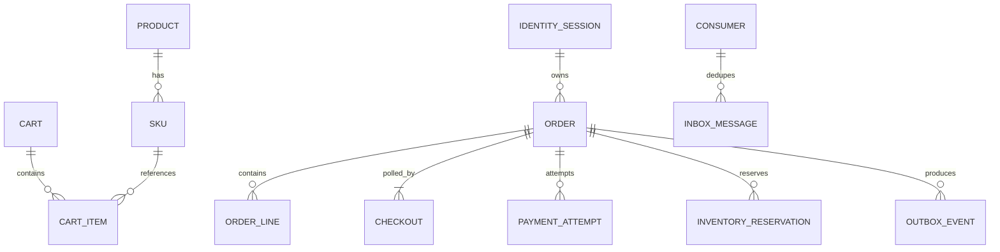
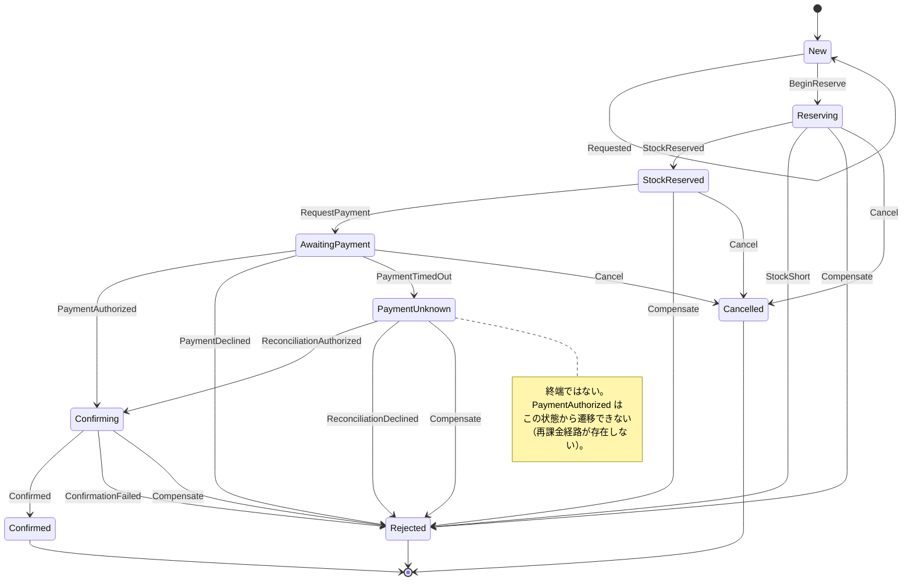
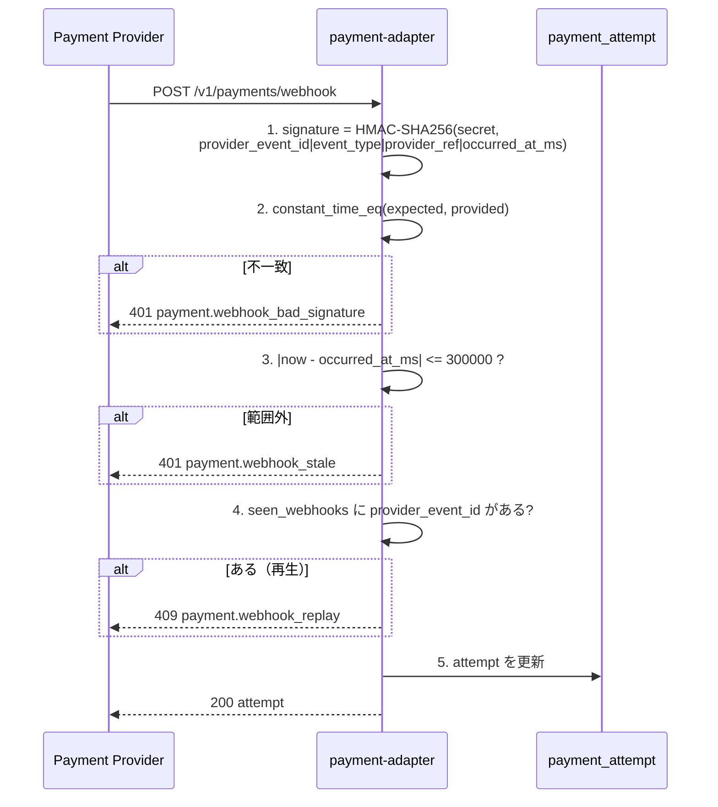

> 文書種別: 独自成果物。基準日: 2026-10-17。
> 機械可読な契約は `D:/DOKIPON/contracts/openapi.yaml` と各サービスの実装に優先する。
> 未実装のものは必ず `[Designed]` と書く。

# API・DB・状態機械 詳細設計（Detailed Design）

## 1. OpenAPI 3.1 Operation 一覧

| Operation ID | Method / URL | Auth | Request | Response | Error | 実装状態 |
|---|---|---|---|---|---|---|
| `storefront.get` | GET `/v1/storefront` | none | `X-Channel` header | channel 別 capability / catalog / checkout 設定 | — | [Observed] `:8080` |
| `catalog.list` | GET `/v1/products` | optional | `cursor` `limit`(1-100) `locale` `categoryId` `channel` | `{items[], next_cursor}` | 400 / 429 / 503 | [Observed] `:8081` |
| `catalog.detail` | GET `/v1/products/{productId}` | optional | path | product + `price{amountMinor,currency}` + `version` + `stockPolicy` + `channelEligibility` | 404 / 410 | [Observed] |
| `cart.get` | GET `/v1/carts/{cartId}` | session | path | cart | 401 / 403 / 404 | [Observed] `:8083` |
| `cart.update` | PATCH `/v1/carts/{cartId}/items/{sku}` | session + `Idempotency-Key` | `{quantity, expectedVersion}` | `{cartId, version, items[]}` | 401 / 409 / 422 | [Observed] |
| `checkout.submit` | POST `/v1/checkouts` | session + `Idempotency-Key` | `{lines[], paymentMethodRef}` | `{checkoutId, status}` | 401 / 409 / 422 / 429 / 503 | [Observed] `:8085` |
| `checkout.status` | GET `/v1/checkouts/{checkoutId}` | owner | path | authoritative status | 403 / 404 / 503 | [Observed] |
| `checkout.reconcile` | POST `/v1/orders/{orderId}/reconcile` | server-only | `{authorized: bool}` | final state | 403 / 404 / 409 | [Observed] |
| `orders.list` | GET `/v1/orders` | owner | — | `{items[]}` | 401 / 403 | [Observed] |
| `orders.detail` | GET `/v1/orders/{orderId}` | owner | path | order + `timeline[]` | 401 / 403 / 404 | [Observed] |
| `identity.liff` | POST `/v1/sessions/line` | LIFF id_token | `{id_token, nonce}` | short-lived session | 401 / 403 / 429 | [Observed] `:8082` |
| `identity.guest` | POST `/v1/sessions/guest` | none | `{channel}` | guest session | — | [Observed] |
| `inventory.reserve` | POST `/v1/inventory/reservations` | service | `{sku, order_id, quantity}` | reservation | 404 / 409 / 422 | [Observed] `:8084` |
| `inventory.commit` | POST `/v1/inventory/reservations/{id}/commit` | service | path | reservation | 404 / 409 | [Observed] |
| `inventory.release` | POST `/v1/inventory/reservations/{id}/release` | service | path | reservation | 404 / 409 | [Observed] |
| `payment.authorize` | POST `/v1/payments/authorize` | service | `{order_id, payment_method_ref, amount_minor, currency}` | attempt (`authorized`/`declined`/`unknown`) | 422 | [Observed] `:8086` |
| `payment.reconcile` | POST `/v1/payments/reconcile` | service | `{provider_ref, provider_answer}` | attempt | 404 / 409 | [Observed] |
| `payment.webhook` | POST `/v1/payments/webhook` | HMAC | `{provider_event_id, event_type, provider_ref, occurred_at_ms, signature}` | attempt | 401 / 404 / 409 / 400 | [Observed] |

### 1.1 意味論（Atlas §C）

- `Idempotency-Key` は UUID、`(actor_id, operation)` でスコープ。TTL 24h。
  **同じキー + 異なる payload は 409**。同じキー + 同じ payload は保存済みレスポンスを再生。
- `POST /v1/checkouts` の `201` は確定、`202` は処理中。**失敗や不明支払を 200 success にしない**。
- `GET /v1/checkouts/{id}` が authoritative status。クライアントは POST を再送せず、
  GET するか同じキーで replay する。
- `Authorization` はサーバ側の権限判定。LIFF token をクライアント側の権限の代用にしない。
- エラーは `application/problem+json`:
  `{type, title, status, code, detail, traceId, retryable}`。`retryable` で分岐させる。
- Money は `{amountMinor: int64, currency: ISO4217}`。業務金額に浮動小数を使わない。時刻は UTC RFC3339。
- 可変 enum の未知値には防御的 fallback（`CheckoutStatus.unknown` / `Currency.jpy`）。

## 2. DB / ER

> **注意**: この schema は実在する — `services/crates/commerce-core/migrations/0001_commerce.sql` が
> それである。デプロイは `DATABASE_URL` があれば起動時に適用する（冪等、`IF NOT EXISTS` のみ）。
> **複数の Function インスタンスが同時に適用しても壊れない**ように、適用は
> advisory lock を保持したトランザクションの中で行う（`CREATE TABLE IF NOT EXISTS` は
> 同時実行するとカタログで衝突する）。
> 下の DDL は**設計時の形**であり、ID は `uuid` ではなく実装どおりの `text`
> （`sku-bra-01` / `ord-000001` / `sess-000001`）、時刻は `timestamptz` ではなく
> 実装どおりの `bigint`（ミリ秒）である。**記録の正本はマイグレーションファイル**、
> この節は設計理由と差分を語っているだけ。
> 現在 DB を使うのは **5 つのサービス全部** — identity（セッション）、cart（カート）、
> order（注文）、inventory（在庫台帳）、payment（支払の試行）。どれも `DATABASE_URL` が
> あれば **DB が正本**、なければプロセス内メモリ（ローカル実行とプロセス内 edge は
> あえてメモリ）。**DB がある**のに繋がらないときは**起動しない**（fail closed）：
> 繋がらないのにプロセス内メモリへこっそり逃がすと、表向きは健康に見えて注文は消える。
> セッションの id・注文の id・在庫の予約の id は **DB の sequence** から来る
> （`sess-000001` / `ord-000001` / `res-000001`）ので、二つのインスタンスが同じ
> id を出すことはない —— 同じ id は**別の客人が共有している**ことになる。



```sql
-- catalog service
CREATE TABLE product (
  product_id     uuid PRIMARY KEY,
  published      boolean     NOT NULL DEFAULT false,
  category_id    text        NOT NULL,
  title_i18n     jsonb       NOT NULL DEFAULT '{}',
  channel_eligibility jsonb  NOT NULL
                 DEFAULT '{"web":true,"app":true,"line_mini_app":true}',
  CHECK (jsonb_typeof(channel_eligibility) = 'object')
);
CREATE INDEX ON product (category_id) WHERE published;

CREATE TABLE sku (
  sku_id         uuid PRIMARY KEY,
  product_id     uuid NOT NULL REFERENCES product(product_id),
  currency       char(3)     NOT NULL,
  amount_minor   bigint      NOT NULL,
  stock_policy   text        NOT NULL CHECK (stock_policy IN ('unbounded','reserved','made_to_order')),
  version        integer     NOT NULL DEFAULT 1 CHECK (version >= 1)
);

-- cart service
CREATE TABLE cart (
  cart_id        uuid PRIMARY KEY,
  owner_id       uuid,                       -- NULL = anonymous
  version        integer NOT NULL DEFAULT 1 CHECK (version >= 1),
  expires_at     timestamptz NOT NULL
);
CREATE TABLE cart_item (
  cart_id        uuid NOT NULL REFERENCES cart(cart_id) ON DELETE CASCADE,
  sku_id         uuid NOT NULL,
  quantity       integer NOT NULL CHECK (quantity > 0),
  unit_amount_snapshot bigint NOT NULL,      -- 表示専用。checkout は再計算する
  PRIMARY KEY (cart_id, sku_id)
);

-- inventory service: available = on_hand - reserved, CHECK が負を物理的に防ぐ
CREATE TABLE stock (
  sku_id         uuid PRIMARY KEY,
  on_hand        bigint NOT NULL CHECK (on_hand   >= 0),
  reserved       bigint NOT NULL CHECK (reserved >= 0 AND reserved <= on_hand)
);
CREATE TABLE inventory_reservation (
  reservation_id uuid PRIMARY KEY,
  sku_id         uuid NOT NULL,
  order_id       uuid NOT NULL,
  quantity       bigint NOT NULL CHECK (quantity > 0),
  state          text NOT NULL CHECK (state IN ('pending','reserved','committed','released','expired')),
  expires_at     timestamptz NOT NULL,
  UNIQUE (order_id, sku_id)          -- 二重予約を構造的に不可能にする
);

-- order service
CREATE TABLE "order" (
  order_id       uuid PRIMARY KEY,
  buyer_id       uuid NOT NULL,
  state          text NOT NULL CHECK (state IN ('new','reserving','stock_reserved',
                        'awaiting_payment','payment_unknown','confirming',
                        'confirmed','rejected','cancelled')),
  currency       char(3)   NOT NULL,
  amount_minor   bigint    NOT NULL CHECK (amount_minor >= 0),
  reservation_id uuid,
  provider_ref   text,
  awaiting_reconciliation boolean NOT NULL DEFAULT false,
  transitions_used integer NOT NULL DEFAULT 0 CHECK (transitions_used >= 0),
  created_at     timestamptz NOT NULL DEFAULT now()
);
CREATE INDEX ON "order" (buyer_id, order_id);

CREATE TABLE order_line (
  order_id       uuid NOT NULL REFERENCES "order"(order_id),
  line_no        integer NOT NULL,
  sku_id         uuid NOT NULL,
  quantity       integer NOT NULL CHECK (quantity > 0),
  unit_amount_minor bigint NOT NULL CHECK (unit_amount_minor >= 0),
  PRIMARY KEY (order_id, line_no)
);

CREATE TABLE checkout (
  checkout_id    uuid PRIMARY KEY,
  order_id       uuid NOT NULL REFERENCES "order"(order_id),
  trace_id       text NOT NULL
);

-- 一つの (actor, key) につき有効な fingerprint はひとつ
CREATE TABLE idempotency_record (
  scoped_key         text PRIMARY KEY,     -- sha256(actor||operation||client_key)
  request_fingerprint text NOT NULL,
  state            text NOT NULL CHECK (state IN ('in_progress','completed')),
  response_status  integer,
  response_body    jsonb,
  created_at       timestamptz NOT NULL DEFAULT now(),
  expires_at       timestamptz NOT NULL,
  UNIQUE (scoped_key, request_fingerprint)
);

CREATE TABLE outbox_event (
  event_id       uuid PRIMARY KEY,
  aggregate_id   text NOT NULL,
  topic          text NOT NULL,
  schema_version integer NOT NULL,
  correlation_id text NOT NULL,
  causation_id   text,
  traceparent    text,
  payload        jsonb NOT NULL,
  occurred_at    timestamptz NOT NULL,
  published_at   timestamptz,
  CHECK (jsonb_typeof(payload) = 'object')
);
CREATE INDEX ON outbox_event (topic, published_at) WHERE published_at IS NULL;

-- identity service
CREATE TABLE identity_session (
  session_id   uuid PRIMARY KEY,
  kind         text NOT NULL CHECK (kind IN ('guest','line_user')),
  channel      text NOT NULL CHECK (channel IN ('web','app','line')),
  subject      text,                        -- LINE user id。表示名は取らない
  issued_at    timestamptz NOT NULL,
  expires_at   timestamptz NOT NULL,
  revoked      boolean NOT NULL DEFAULT false
);
CREATE TABLE consumed_nonce (
  nonce        text PRIMARY KEY,
  consumed_at  timestamptz NOT NULL
);
```

**クロサービス FK を作らない**理由: サービス境界を越えた FK は独立デプロイと
障害ドメインの独立化を壊す。整合は ID とイベントで取る。

## 3. CheckoutState 状態機械

`commerce_core::transition(state, event, transitions_used)` は純関数。
`transitions_used >= 32` で `BudgetExhausted`、`is_terminal` 後は `AlreadyTerminal`。



### 3.1 拒否理由（成功に偽装してはいけない 3 つ）

| 拒否 | 意味 | HTTP | クライアントの挙動 |
|---|---|---|---|
| `AlreadyTerminal` | すでに終端 | 409 `order.already_terminal` | 注文を再取得 |
| `IllegalEvent` | 遷移表に無い | 409 `order.illegal_transition` | エラーを表示し**再試行しない** |
| `BudgetExhausted` | 32 回超過 | 409 `order.budget_exhausted` | 人間レビューへ escalate |

### 3.2 Reservation 状態機械

| 現在 | イベント | 次 | 在庫への影響 |
|---|---|---|---|
| — | `reserve(sku, order, qty)` | Reserved | `reserved += qty`（`available >= qty` のときのみ） |
| Reserved | `commit` | Committed | `reserved -= qty`, `on_hand -= qty` |
| Reserved | `release` | Released | `reserved -= qty`（on_hand は戻す） |
| Reserved | TTL 超過 | Released / Expired | `release` と同じ（**commit ではない**） |
| Committed/Released/Expired | 任意の commit/release | — | 409 `inventory.reservation_terminal` |

**冪等予約**: `(order_id, sku_id)` に UNIQUE 制約があるため、二度目の予約は別 ID を作らず同じ
`reservation_id` を返す。

## 4. Event / Outbox / Inbox

| Event | producer | consumer | once strategy | compensation |
|---|---|---|---|---|
| `order.requested` | Order | Notification | event id dedupe | retry only |
| `inventory.stock_reserved` | Inventory | Order | reservation id uniqueness | release pending reserve |
| `payment.authorized` | Payment adapter | Order | provider ref dedupe | reverse/refund per provider |
| `payment.unknown` | Payment adapter | Reconciliation | reconcile polling | **never charge twice** |
| `order.confirmed` | Order | Fulfillment, Notification | outbox+consumer dedupe | notification retry only |
| `order.rejected` | Order | Inventory, Notification | version check | release reservation |
| `order.compensation_requested` | Order | Inventory, Payment | idempotency key | release / refund |
| `payment.reconciled` | Payment adapter | Order | version check | settle or compensate |

### 4.1 メッセージ信封

```json
{
  "eventId": "uuid",
  "schemaVersion": 1,
  "correlationId": "…",
  "causationId": "…",
  "traceparent": "00-…",
  "occurredAt": "2026-10-17T12:00:00Z",
  "aggregateId": "ord-000123",
  "type": "payment_unknown",
  "data": { "providerRef": "pref_000000000042" }
}
```

- producer は **aggregate と Outbox を同一 DB トランザクションで commit** する。
- consumer は **Inbox キーで重複処理を除去**し、順序が必要な aggregate は version で制御。
- **PII を broker payload に流さない。**
- **配信保証は at-least-once。** end-to-end exactly-once を宣言しない。

### 4.2 リトライ → DLQ → 人間レビュー

| 段階 | 条件 | 動作 | 記録 |
|---|---|---|---|
| 1 次 | publish 失敗 / consume 失敗 | 指数バックオフで再試行（例: 1s, 4s, 16s, 64s） | `attempt`, `last_error` |
| DLQ | 上限到達（例: 5 回） | DLQ テーブルへ移動 | `dlq_at`, `topic`, `payload`, `traceparent` |
| 人間レビュー | DLQ 進入 | 担当者に通知。**自動で成功にしない** | `operator`, `reviewed_at`, `resolution` |

**S0 判定**: 決済成功後に order 書込が失敗したケース（`AuthorizedButOrderWriteFailed`）は
`order.rejected` + `compensation_requested(refund)` + `awaiting_reconciliation = true` を出す。
`confirmed` にはしない。Refs: `commerce_order::tests::capture_then_order_write_failure_never_confirms`。

## 5. Webhook 検証手順（Payment adapter）



5 つのうちどれか 1 つでも落ちたら状態は更新しない。`constant_time_eq` は長さ依存で-content に依存しない。

## 6. クライアント側の契約遵守

| 制約 | クライアントでの実装 | テスト |
|---|---|---|
| Money は整数最小単位 | `Money` に `double` を持たせない | `domain_models_test.dart` Money 群 |
| `payment_unknown` は poll | `CheckoutStatus.isTerminal == false` | `payment_unknown is neither terminal nor a failure` |
| 冪等キーは操作に固定 | `IdempotencyKeyFactory.keyFor(op)` は同一 op で同値 | `IdempotencyKeyFactory` |
| 未知 enum に耐性 | `parse()` が `.unknown` に縮退 | `an unknown server state degrades` |
| チャネル制限 | `x-channel` ヘッダを必ず送る | 実 HTTP で確認済み |

## 7. 関連文書

- 基本設計：`../02-basic/基本設計書.md`
- セキュリティ：`../04-detailed/セキュリティ設計.md`
- テスト設計：`../05-test/テスト設計書.md`
