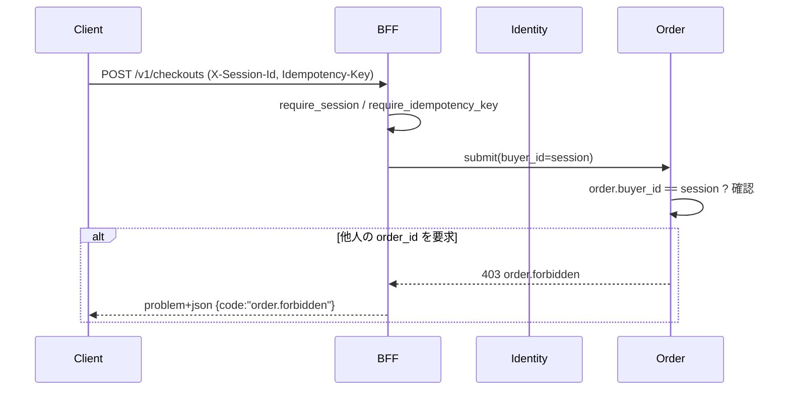

> 文書種別: 独自成果物。基準日: 2026-10-17。
> 本書の「実装済み」はテストまたはコード構造で確認できるものだけを指す。

# セキュリティ設計・脅威分析（Security Design）

## 1. 脅威一覧と実装された対策

| # | 脅威 | 影響 | 予防（実装） | 検知 | 対象テスト |
|---|---|---|---|---|---|
| SEC-01 | 偽造 LINE `id_token` | 他者の LINE アカウントで注文 | issuer / audience / signature / exp / nonce の5重検証。`alg != HS256` は拒否 | 401 のログと traceId | `commerce-identity`: `wrong_signature_is_rejected`, `wrong_audience_is_rejected`, `wrong_issuer_is_rejected`, `expired_token_is_rejected`, `nonce_must_match`, `alg_none_and_algarbitrary_are_rejected` |
| SEC-02 | `alg:none` / アルゴリズム差し替え | 署名検証の無効化 | JWS header を解析して `alg` を明示照合 | — | `alg_none_and_algarbitrary_are_rejected` |
| SEC-03 | id_token の再生 | 盗まれたトークンでのログイン | nonce の一回限使用 + TTL 内チェック | `consumed_nonce` の記録 | `nonce_replay_is_refused` |
| SEC-04 | Webhook 偽造 | 架空の入金通知 | HMAC-SHA256、定数時間比較 | — | `webhook_signed_with_the_wrong_secret_is_rejected` |
| SEC-05 | Webhook 再生 | 同一イベントの二重適用 | `provider_event_id` の一意制約＋seen テーブル | 409 `payment.webhook_replay` | `webhook_rejects_a_replay` |
| SEC-06 | Webhook 古い署名 | 長寿命署名のリプレイ | 時刻窓 ±5分 | 401 `payment.webhook_stale` | `webhook_rejects_a_stale_timestamp` |
| SEC-07 | IDOR（他者の注文閲覧） | 個人情報・購入履歴の漏えい | 所有者チェックを**応答生成より前**に実行。NG は 403（404 にしないのは監査性のため） | 認可失敗ログ | `order_listing_is_scoped_to_the_buyer`, `cart.forbidden` |
| SEC-08 | 価格改ざん | 意図しない低額決済 | 小計を常にサーバ側カタログ価格から再計算。クライアント `unit_amount_snapshot` は表示専用 | — | `subtotal_is_computed_from_authoritative_prices`, `cart_subtotal_uses_authoritative_prices_for_two_skus` |
| SEC-09 | 二重コミット竞争 | 二重予約・在庫の過sold | `stock.reserved <= on_hand` の CHECK、`(order_id, sku_id)` UNIQUE、楽観 lock `expectedVersion` | 409 返却 | `concurrent_last_item_only_one_winner`, `stale_expected_version_is_conflict_not_overwrite` |
| SEC-10 | 決済不明時の盲目再試行 | **二重課金** | `PaymentUnknown` に `PaymentAuthorized` 遷移が存在しない。クライアントも poll のみ | `awaiting_reconciliation` の監視 | `payment_timeout_is_unknown_not_failed_and_not_success`, `unknown_resolves_only_via_reconciliation` |
| SEC-11 | 決済成功後の Order 書込失敗 | 入金済みだが注文なし | `ConfirmationFailed` → `Rejected` + 補償要求。`Confirmed` にしない | `reconciliation_required`, `awaiting_reconciliation` | `capture_then_order_write_failure_never_confirms` |
| SEC-12 | 秘密・カード情報の漏えい | 個人情報保護法違反・PCI 違反 | カード番号はどのプロセスにも入らない。`payment_method_ref` は応答に含めない | secret manager 経由のみ | `authorize_returns_a_provider_ref_never_card_data` |
| SEC-13 | 署名比較のタイミング情報 | 秘密値の推測 | `constant_time_eq`（長さ・内容非依存） | — | `constant_time_eq_behaves_like_equality` |
| SEC-14 | セッション固定 | 別人の権限を取得 | 発行時に UUID 採番、失効 API あり、短命 TTL | `revoked` フラグ | `revocation_invalidates_a_session_immediately`, `unknown_session_is_unauthorized` |
| SEC-15 | レート制限の回避 | 総当たり・スパム | BFF の固定窓 600/min（session 単位） | 429 | `rate_limiter_blocks_after_the_budget`, `rate_limiter_window_resets` |
| SEC-16 | 冪等キー再利用攻撃 | 意図しない重複注文 | `(actor, operation)` スコープ + payload fingerprint。異 payload は 409 | `idempotency_record` の fingerprint | `duplicate_idempotency_key_different_payload_is_409`, `scoped_key_separates_actors_and_operations` |
| SEC-17 | ゲスト状態の権限昇格 | LINE アプリ内で未ログインの状態で注文 | `SessionKind::Guest && channel == line` → `can_checkout() == false`。クライアントは購入ボタンを無効化し、理由を示す。**Web/App のゲストは注文できる** —— Web のストアは物販店であり、カタログではない（要件 FR-IDENTITY-04）。サーバ側では Web/App のゲストの注文を区別しない（注文は session で紐づく） | `a_guest_in_the_line_app_may_browse_but_not_check_out`, `a_guest_on_the_web_may_check_out` |
| SEC-18 | LINE 越境コンテンツ | 政策違反によるストア拒否 | `channelEligibility` をサーバ側で強制 | — | `policy_restricted_product_is_excluded_from_line_and_app`（実 HTTP でも確認） |
| SEC-19 | ログへの秘密混入 | 事後調査での二次被害 | `AppError::Internal` は詳細をログにのみ出し、応答 body には含めない | — | `problem_details_render_the_contract_fields` |
| SEC-20 | Channel Secret の bundle 混入 | LINE アカウントの乗っ取り | LIFF ID のみを `--dart-define` で注入。Secret は Dart/JS のどこにも書かない | ビルド成果物の走査（CI で実施） | 構造的に保証 |

## 2. 認証と認可の流れ



**原則**: 認可はサーバのみで決定する。クライアントが `role: "admin"` のような値を送っても意味を持たない。

## 3. LINE 固有の防御

| Case | 条件 | 本実装の挙動 | 証拠等級 |
|---|---|---|---|
| LIFF-001 | SDK 読込 + init 成功 | 匿名閲覧可。プロフィール自動取得はしない | [Observed] |
| LIFF-002 | LIFF ID 未設定 | `LIFF_ID_NOT_CONFIGURED`。商品機能は継続 | [Observed] |
| LIFF-003 | SDK ネット失敗 | `SDK_LOAD_FAILED` → 通常 Web に降格。**リダイレクト/再読み込みなし** | [Observed] |
| LIFF-004 | 外部 Chrome/Safari | `getIDToken` を呼ばない。ゲスト閲覧可 | [Observed] |
| LIFF-005 | 未ログイン | 購入時のみ促す。自動遷移ループを作らない | [Observed] |
| LIFF-006 | 同意撤回 | id_token を取らずゲスト降格。取得済みデータも破棄 | [Observed] |
| LIFF-008 | 戻る/最小化/閉じる | LINE ヘッダーが主導。`viewport-fit=cover` で安全領域を確保 | [Designed]（実機未検証） |
| LIFF-009 | プライバシー文書/提供元情報欠落 | `index.html` の meta が空のまま = **提出をブロックすべき状態** | [Observed] |
| LIFF-010 | 政策除外コンテンツ | カタログ側で除外 | [Observed] |

## 4. Privacy by Design

| 原則 | 実装 | 証拠等級 |
|---|---|---|
| 目的限定 | 注文履行に必要な項目のみ取得。氏名/住所は Order にのみ保持 | [Designed] |
| データ最小化 | Identity は LINE `subject` のみ保持。表示名・メールアドレス・アイコン URL は**取らない** | [Observed] |
| 保存前同意 | 決済トークンは provider token のみ。カード情報は保存しない | [Observed] |
| ログ匿名化 | ログは traceId / orderId / provider_ref。`sessionId` はハッシュ化を検討 | [Designed] |
| アクセス経路 | ログに `id_token` / `payment_method_ref` / secret を書かない | [Observed] |
| 削除請求 | `revoke` で session 無効化。削除受付窓口は法務判断待ち | [Designed] |
| 保存期間 | 要件定義で確定（法令・運用判断） | [Designed] |

## 5. Release Blockers（公開前に必ず潰す）

| # | Blocker | 現状 | 判定 |
|---|---|---|---|
| RB-01 | 本番認証バックエンド | メモリ実装のみ。identity は単一インスタンス前提 | **ブロック** |
| RB-02 | Postgres 接続と migration | 未接続。schema は本書の DDL 案のみ | **ブロック** |
| RB-03 | 実 PSP 接続 | `ProviderScript` によるスクリプト動作のみ | **ブロック** |
| RB-04 | 秘密管理（PSP secret / LINE channel secret） | 環境変数のみ。secret manager 未接続 | **ブロック** |
| RB-05 | 利用規約・個人情報保護方針 | 未作成 | **ブロック** |
| RB-06 | LINE MINI App 審査 | 未申請 | **ブロック（LINE チャネル公開時）** |
| RB-07 | 法的審査（商品区分・広告表現） | 未判定。`p-adult-01` は「要審査」のサンプル | **ブロック（該当商品を公開する場合）** |
| RB-08 | 証拠のない通信トポロジの本番化 | 原則として禁止 | 継続監視 |
| RB-09 | TLS 終端 | 未実施（local は HTTP） | **ブロック** |

> 本表の 9 項目が未解決であるため、**本リポジトリを現状で本番公開してはならない**。

## 6. セキュリティテスト自動化

CI に組み込むべきゲート（すべて既存コードで検証可能）:

```text
cargo test -p commerce-identity        # SEC-01..03, SEC-14
cargo test -p commerce-payment-adapter  # SEC-04..06, SEC-12, SEC-13
cargo test -p commerce-inventory        # SEC-09
cargo test -p commerce-cart             # SEC-08
cargo test -p commerce-order            # SEC-10, SEC-11, SEC-16
cargo test -p commerce-bff              # SEC-15
flutter test packages/domain_models     # クライアント側の縮退
```

## 7. 関連文書

- 非機能要件（セキュリティ分類）: `../01-requirements/非機能要件定義書.md`
- 詳細設計（webhook 手順）: `../03-detailed/API・DB・状態機械設計.md`
