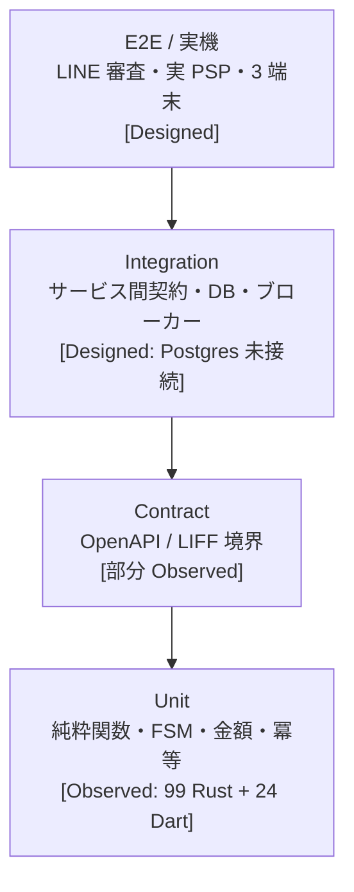

> 文書種別: 独自成果物。基準日: 2026-10-17。
> 終端結果の規約は Atlas に従い `success` / `failed` / `recovered` の 3 値。
> **未実行のケースは PASS と書かない。** 実施済みでないものは `[Designed]`。

# テスト設計書（Test Design）

## 1. テスト层次



現状は **UT だけが完全に Observed**。上 3 層の設計は存在するが実行環境がない。

## 2. implemented ユニットテスト一覧（実行済み）

### CASE-CORE — 金額と冪等（commerce-core, 24 件）

| Case ID | ケース | 期待終端 | 結果 |
|---|---|---|---|
| CASE-MONEY-001 | 負の金額は拒否 | failed（`ArgumentError`） | PASS [Observed] |
| CASE-MONEY-002 | 異通貨の加算はエラー | failed | PASS [Observed] |
| CASE-MONEY-003 | `i64::MAX + 1` は wrap しない | failed（`Overflow`） | PASS [Observed] |
| CASE-MONEY-004 | 数量乗算 | success | PASS [Observed] |
| CASE-MONEY-005 | JPY の指数は 0 | success | PASS [Observed] |
| CASE-IDEM-001 | 記録なし → Execute | success | PASS [Observed] |
| CASE-IDEM-002 | 同キー異 payload → 409 | failed | PASS [Observed] |
| CASE-IDEM-003 | 同キー同 payload・処理中 → conflict（**再実行しない**） | failed | PASS [Observed] |
| CASE-IDEM-004 | 完了済み → 保存レスポンス再生 | recovered | PASS [Observed] |
| CASE-IDEM-005 | 期限切れ → Execute | success | PASS [Observed] |
| CASE-IDEM-006 | scoped key が actor/operation を分離 | success | PASS [Observed] |
| CASE-IDEM-007 | fingerprint が順序安定・区切り文字安全 | success | PASS [Observed] |
| CASE-FSM-001 | 正常系が Confirmed 到達 | success | PASS [Observed] |
| CASE-FSM-002 | 在庫切れは Confirmed にしない | failed（Rejected） | PASS [Observed] |
| CASE-FSM-003 | 決済拒否は予約解放 | failed（Rejected） | PASS [Observed] |
| CASE-FSM-004 | 決済 timeout は Unknown（失敗でも成功でもない） | failed ではない（Unknown） | PASS [Observed] |
| CASE-FSM-005 | Unknown からの脱出は reconcile のみ | failed | PASS [Observed] |
| CASE-FSM-006 | 確認失敗は Confirmed にならない | failed（Rejected） | PASS [Observed] |
| CASE-FSM-007 | 終端状態は追加イベントを拒否 | failed | PASS [Observed] |
| CASE-FSM-008 | 予算超過は拒否（成功に偽装しない） | failed | PASS [Observed] |
| CASE-FSM-009 | 同一入力は同一結果（再生可能性） | success | PASS [Observed] |
| CASE-EVT-001 | event topic が一意 | success | PASS [Observed] |

### CASE-CATALOG — 商品（commerce-catalog, 5 件）

| Case ID | ケース | 期待終端 | 結果 |
|---|---|---|---|
| CASE-CATALOG-001 | 価格は正、version >= 1 | success | PASS [Observed] |
| CASE-CATALOG-002 | ロケール ja → any フォールバック | success | PASS [Observed] |
| CASE-CATALOG-003 | 在庫状態と表示の整合 | success | PASS [Observed] |
| CASE-CATALOG-004 | 政策制限商品は LINE/App から除外 | success | PASS [Observed] |
| CASE-CATALOG-005 | 実 HTTP で channel 絞り込み（`:8081`） | success | PASS [Observed]（curl で確認） |

### CASE-CART — カート（commerce-cart, 7 件）

| Case ID | ケース | 期待終端 | 結果 |
|---|---|---|---|
| CASE-CART-001 | 変更で version が上がる | success | PASS [Observed] |
| CASE-CART-002 | 古い version は 409、状態は不変 | failed | PASS [Observed] |
| CASE-CART-003 | quantity=0 で明細削除 | success | PASS [Observed] |
| CASE-CART-004 | 小計はサーバ側価格から算出（改ざん耐性） | success | PASS [Observed] |
| CASE-CART-005 | 2 SKU でも改ざん耐性 | success | PASS [Observed] |
| CASE-CART-006 | 未知 SKU は 0 円ではなくエラー | failed | PASS [Observed] |
| CASE-CART-007 | 存在しないカートは 404 | failed | PASS [Observed] |

### CASE-INVENTORY — 在庫（commerce-inventory, 9 件）

| Case ID | ケース | 期待終端 | 結果 |
|---|---|---|---|
| CASE-INVENTORY-001 | reserve → commit で on_hand と reserved が減る | success | PASS [Observed] |
| CASE-INVENTORY-002 | reserve → release で availability 復元 | recovered | PASS [Observed] |
| CASE-INVENTORY-003 | availability は負にならない | failed（409） | PASS [Observed] |
| CASE-INVENTORY-004 | 最後の 1 個を并发取得、片方のみ成功 | failed（片方） | PASS [Observed] |
| CASE-INVENTORY-005 | 同一注文の二重予約は冪等 | success | PASS [Observed] |
| CASE-INVENTORY-006 | 終端予約は二重 commit/release 不可 | failed | PASS [Observed] |
| CASE-INVENTORY-007 | TTL 失効は release（commit でない） | recovered | PASS [Observed] |
| CASE-INVENTORY-008 | TTL sweep は冪等（2 回目は 0 件） | success | PASS [Observed] |
| CASE-INVENTORY-009 | 未知 SKU / 不正数量を拒否 | failed | PASS [Observed] |

### CASE-PAYMENT — 決済（commerce-payment-adapter, 15 件）

| Case ID | ケース | 期待終端 | 結果 |
|---|---|---|---|
| CASE-PAYMENT-001 | provider_ref を返し、カード情報は出さない | success | PASS [Observed] |
| CASE-PAYMENT-002 | timeout は Unknown（declined でも success でもない） | failed ではない | PASS [Observed] |
| CASE-PAYMENT-003 | reconcile が Unknown の唯一の脱出路 | recovered | PASS [Observed] |
| CASE-PAYMENT-004 | reconcile → declined も滞留を解消 | failed | PASS [Observed] |
| CASE-PAYMENT-005 | reconcile は冪等 | success | PASS [Observed] |
| CASE-PAYMENT-006 | declined は reconcile 不可 | failed | PASS [Observed] |
| CASE-PAYMENT-007 | capture 後の Order 書込失敗は reconciliation フラグ付き | failed | PASS [Observed] |
| CASE-PAYMENT-008 | 金額 0 は拒否 | failed | PASS [Observed] |
| CASE-PAYMENT-009 | 偽署名の webhook を拒否 | failed | PASS [Observed] |
| CASE-PAYMENT-010 | 古い timestamp の webhook を拒否 | failed | PASS [Observed] |
| CASE-PAYMENT-011 | webhook の再生を拒否 | failed | PASS [Observed] |
| CASE-PAYMENT-012 | 正しい webhook が attempt を更新 | success | PASS [Observed] |
| CASE-PAYMENT-013 | 別 secret での署名を拒否 | failed | PASS [Observed] |
| CASE-PAYMENT-014 | refund で終端化 | failed | PASS [Observed] |
| CASE-PAYMENT-015 | 定数時間比較が等価判定と等価 | success | PASS [Observed] |

### CASE-IDENTITY — 認証（commerce-identity, 15 件）

| Case ID | ケース | 期待終端 | 結果 |
|---|---|---|---|
| CASE-IDENTITY-001 | 正しい token の claims 取得 | success | PASS [Observed] |
| CASE-IDENTITY-002 | 誤署名を拒否 | failed | PASS [Observed] |
| CASE-IDENTITY-003 | 誤 audience を拒否 | failed | PASS [Observed] |
| CASE-IDENTITY-004 | 誤 issuer を拒否 | failed | PASS [Observed] |
| CASE-IDENTITY-005 | 期限切れを拒否 | failed | PASS [Observed] |
| CASE-IDENTITY-006 | nonce 不一致を拒否 | failed | PASS [Observed] |
| CASE-IDENTITY-007 | `alg:none` を拒否 | failed | PASS [Observed] |
| CASE-IDENTITY-008 | 壊れた token を拒否 | failed | PASS [Observed] |
| CASE-IDENTITY-009 | guest は閲覧のみ | success（閲覧）/ failed（購入） | PASS [Observed] |
| CASE-IDENTITY-010 | LINE session は自分の注文のみ閲覧可 | success | PASS [Observed] |
| CASE-IDENTITY-011 | nonce 再生は拒否 | failed | PASS [Observed] |
| CASE-IDENTITY-012 | revoke で即時無効 | failed | PASS [Observed] |
| CASE-IDENTITY-013 | 未知 session は 401 | failed | PASS [Observed] |
| CASE-IDENTITY-014 | base64url の往復 | success | PASS [Observed] |
| CASE-IDENTITY-015 | HMAC の決定性 | success | PASS [Observed] |

### CASE-ORDER — Saga（commerce-order, 15 件）

| Case ID | ケース | 期待終端 | 結果 |
|---|---|---|---|
| CASE-ORDER-001 | 正常系が Confirmed | success | PASS [Observed] |
| CASE-ORDER-002 | 決済拒否 → Rejected + 補償要求 | failed | PASS [Observed] |
| CASE-ORDER-003 | 決済 timeout → Unknown（非終端） | failed ではない | PASS [Observed] |
| CASE-ORDER-004 | reconcile authorized → Confirmed | recovered | PASS [Observed] |
| CASE-ORDER-005 | reconcile declined → Rejected | failed | PASS [Observed] |
| CASE-ORDER-006 | Unknown でない注文の reconcile は拒否 | failed | PASS [Observed] |
| CASE-ORDER-007 | capture 後 Order 書込失敗は Confirmed にならない | failed | PASS [Observed] |
| CASE-ORDER-008 | 同キー同 payload は同じ checkout を返す | success | PASS [Observed] |
| CASE-ORDER-009 | 同キー異 payload は 409 | failed | PASS [Observed] |
| CASE-ORDER-010 | 冪等キーはユーザーでスコープ | success | PASS [Observed] |
| CASE-ORDER-011 | 異通貨混在注文を拒否 | failed | PASS [Observed] |
| CASE-ORDER-012 | 空カートを拒否 | failed | PASS [Observed] |
| CASE-ORDER-013 | 合計はサーバ側価格 × 数量 | success | PASS [Observed] |
| CASE-ORDER-014 | 一覧は買い手スコープ | success | PASS [Observed] |
| CASE-ORDER-015 | Saga のトレイルが再生可能（同一入力→同一トレイル） | success | PASS [Observed] |

### CASE-BFF — エッジ（commerce-bff, 9 件）

| Case ID | ケース | 期待終端 | 結果 |
|---|---|---|---|
| CASE-BFF-001 | channel パース既定値は web | success | PASS [Observed] |
| CASE-BFF-002 | 予算超過で 429 | failed | PASS [Observed] |
| CASE-BFF-003 | 窓のリセット | success | PASS [Observed] |
| CASE-BFF-004 | session 欠落で 401 | failed | PASS [Observed] |
| CASE-BFF-005 | 空 session も欠落扱い | failed | PASS [Observed] |
| CASE-BFF-006 | Idempotency-Key 欠落で 400 | failed | PASS [Observed] |
| CASE-BFF-007 | problem+json が契約を満たす | success | PASS [Observed] |
| CASE-BFF-008 | LINE の capability（externalBrowserOpen=true） | success | PASS [Observed]（実 HTTP で確認） |
| CASE-BFF-009 | Web の capability（nativeShare=true） | success | PASS [Observed] |

### CASE-CLIENT — クライアント（domain_models, 24 件）

| Case ID | ケース | 期待終端 | 結果 |
|---|---|---|---|
| CASE-CLIENT-001..006 | Money: 整数保持・負数拒否・通貨表記・乗算・異通貨加算拒否・防御的 parse | — | PASS [Observed] |
| CASE-CLIENT-007..010 | CheckoutStatus: Unknown は非終端、終端判定、未知値の縮退 | — | PASS [Observed] |
| CASE-CLIENT-011..015 | ApiProblem: 冪等冲突・未決決済・version 冲突・problem 解析 | — | PASS [Observed] |
| CASE-CLIENT-016..017 | Session: guest は購入不可、line user は有効期限内のみ有効 | — | PASS [Observed] |
| CASE-CLIENT-018..021 | Product: channel 除外・ロケール fallback・stock policy・ページ | — | PASS [Observed] |
| CASE-CLIENT-022..023 | Cart: スナップショット小計・空カート | — | PASS [Observed] |

**合計: 99 Rust unit + 24 Dart unit + 22 HTTP E2E = 145 検証すべて pass**（`[Observed]`）
**E2E は 3 回連続で同一結果（冪等性・再現性を確認済み）。**

## 2.5 HTTP E2E（実行済み・22 assertions）

`tools/e2e_checkout.sh` は起動中の `commerce-order`（:8085）に対して実 HTTP で検証する。
**3 回連続で 22 passed / 0 failed**（`[Observed]`、実行日 2026-10-17）。

| Case ID | 検証内容 | 期待 | 結果 |
|---|---|---|---|
| CASE-ORDER-001 | 正常系 | status=confirmed | PASS |
| CASE-ORDER-008 | 同キー同 payload の再送 | 同一 checkoutId | PASS |
| CASE-ORDER-009 | 同キー異 payload | 409 `checkout.idempotency_conflict` | PASS |
| CASE-ORDER-010 | キースコープ | 別買い手 → 別 checkout | PASS |
| CASE-ORDER-002 | 決済拒否 | status=rejected | PASS |
| CASE-ORDER-003 | 決済 timeout | status=payment_unknown, terminal=false, awaitingReconciliation=true | PASS |
| CASE-ORDER-004 | reconcile(authorized) | confirmed / 待機解消 / terminal=true | PASS |
| CASE-ORDER-005 | reconcile(declined) | rejected | PASS |
| SEC-07 | 他人の注文を reconcile | 403 | PASS |
| CASE-ORDER-006 | 未解消注文の reconcile | 409 | PASS |
| SEC-07 | 他人の checkout 参照 | 403 | PASS |
| CASE-ORDER-014 | 注文一覧のスコープ | owner=1 / stranger=0 | PASS |
| CASE-ORDER-011 | 異通貨混在 | 422 `order.mixed_currency` | PASS |
| CASE-ORDER-012 | 空カート | 422 | PASS |
| FR-SECURITY-03 | Idempotency-Key 無し write | 400 | PASS |
| CASE-BFF-008/009 | BFF capability（line / web） | 実 HTTP で確認 | PASS |
| CASE-RATELIMIT | BFF 605 リクエスト | 600×200 → 429 `rate.limited` | PASS |
| CASE-BFF-007 | 429 が problem+json | type/title/status/code/traceId/retryable | PASS |

```bash
# 前提: commerce-order が :8085 で起動中
cd D:/DOKIPON && bash tools/e2e_checkout.sh
```

**冪等性について**: サービスは冪等レコードを 24 時間保持するため、スクリプトは
実行ごとに `RUN` プレフィックスを付けてキーとセッション ID を一意化している
（同じキーでの再実行が 200 を返すのは**正しい**動作であり、テストの欠陥ではない）。

## 3. 設計済みだが未実行のケース

以下は**計画**であり、実行環境で再現可能な状態ではない。
部分的足場が `tests/` ディレクトリに用意してあり（`tests/README.md` 参照）、
`tests/integration/e2e_checkout.sh --mocks-up` を `cargo run` できる環境で
実行すれば [IT-002] / [CHAOS-001..003] / [OPS-001] を駆動できる。
それ以外（実端末・実 Postgres・実 PSP・LIFF 実機）は依然として未実行。

| Case ID | ケース | 期待終端 | 状態 |
|---|---|---|---|
| CASE-E2E-001 | 三端末からの完全チェックアウト（成功） | success | [Designed] |
| CASE-E2E-002 | LINE アプリ内からの完全チェックアウト | success | [Designed]（審査必須） |
| CASE-E2E-003 | 外部ブラウザ（Chrome/Safari）から | success（閲覧のみ） | [Designed] |
| CASE-E2E-004 | iOS WKWebView / Android WebView 実機 | success | [Designed] |
| CASE-IT-001 | Postgres に対する migration と制約 | success | [Designed]（DB 未接続） |
| CASE-IT-002 | Outbox → broker → Inbox の再配送 | recovered | [Designed] |
| CASE-IT-003 | サービス間の契約テスト（consumer-driven） | success | [Designed] |
| CASE-CHAOS-001 | PSP 停止時の挙動 | failed（recovered へ対账） | [Designed] |
| CASE-CHAOS-002 | broker 停止時の outbox 蓄積と回復 | recovered | [Designed] |
| CASE-CHAOS-003 | DB 接続断と再接続 | recovered | [Designed] |
| CASE-SEC-001 | SAST / DAST / secret scan | success | [Designed]（CI 未配線） |
| CASE-SEC-002 | LINE bundle に secret が含まれないことの機械検証 | success | [Designed] |
| CASE-OPS-001 | バックアップ復元（RPO 24h / RTO 4h） | success | [Designed]（未実施） |

## 4. チャネル × ケース群マトリクス

| ケース群 | Web | Android | iOS | LINE MINI App | 外部ブラウザ |
|---|---|---|---|---|---|
| カタログ表示 + channel 制限 | Observed | Designed | Designed | **Observed** | **Observed** |
| 認証（LINE session） | N/A | Designed | Designed | Designed | N/A |
| ゲスト閲覧 | N/A | Designed | Designed | Observed | Observed |
| カート楽観排他 | Observed | Designed | Designed | Designed | Designed |
| Saga 正常系 | Observed | Designed | Designed | Designed | Designed |
| PaymentUnknown 対账 | Observed | Designed | Designed | Designed | Designed |
| IDOR 拒否 | Observed | Designed | Designed | Designed | Designed |
| レート制限 | Observed | Designed | Designed | Designed | Designed |

## 5. CI 自動ゲート

| # | ゲート | コマンド | 必須 | 現状 |
|---|---|---|---|---|
| G-01 | Rust 単元テスト | `cargo test --workspace` | はい | 実行可能 [Observed] |
| G-02 | Dart 解析 | `dart analyze`（各 package） | はい | 実行可能 [Observed] |
| G-03 | Dart 単体テスト | `flutter test packages/domain_models` | はい | 実行可能 [Observed] |
| G-04 | Clippy | `cargo clippy --workspace -- -D warnings` | はい | 未実行 |
| G-05 | 3 app の build | `flutter build apk / web` | はい | 未実行（要 SDK chains） |
| G-06 | SAST + secret scan | `cargo audit` / gitleaks | はい | 未配線 |
| G-07 | 契約テスト | OpenAPI との diff | はい | 未配線 |
| G-08 | E2E | サービス起動 + シナリオ | いいえ | 未実装 |

**S0/S1 相当の不変条件（G-01 が既に検出する）**:

- 二重課金（CASE-ORDER-007, CASE-PAYMENT-007）
- 偽 Confirmed（CASE-ORDER-007, CASE-FSM-006）
- 在庫の負（CASE-INVENTORY-003）
- IDOR（CASE-ORDER-014, CASE-SECURITY-02）
- 冪等性破綻（CASE-IDEM-*, CASE-ORDER-008/009）
- 秘密漏えい（CASE-PAYMENT-001, CASE-IDENTITY-002）

## 6. 関連文書

- 要件定義（受入基準 A-01..A-12）: `../01-requirements/要件定義書.md`
- 詳細設計: `../03-detailed/API・DB・状態機械設計.md`
