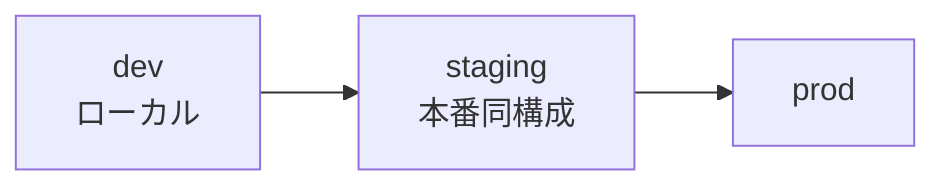
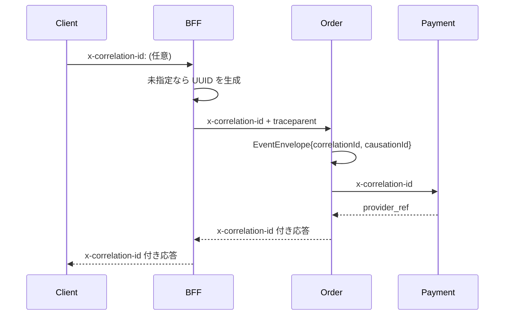

> 文書種別: 独自成果物。基準日: 2026-10-17。
> 数値目標はすべて `[Designed]` であり、実測合格を意味しない。

# 運用設計書（Operations Design）

## 1. 環境分離



| 項目 | dev | staging | prod |
|---|---|---|---|
| 設定の出所 | `.env` / 既定値 | 環境変数 + secret manager | 環境変数 + secret manager |
| API base | `http://127.0.0.1:8080` | 内部 DNS | 公開 TLS |
| 決済 | `ProviderScript`（スクリプト） | PSP ステージング | PSP 本番 |
| LINE | LIFF ID 未設定 → `LIFF_ID_NOT_CONFIGURED` | 実 LIFF ID（テストチャネル） | 実 LIFF ID（審査済み） |
| データ | 毎起動リセット（メモリ） | 匿名データ | 本番データ |
| ログ | `info` | `info` + trace | `warn` + trace |

**コードに環境を分岐させない。** ivariables は全て `--dart-define` と環境変数で supplying する。
`if (kDebugMode) { /* 実決済 */ }` のようなコードを書かない（`FR-CORE-05`）。

```bash
# 例（prod 相当の web build）
flutter build web \
  --dart-define=GEMARC_CHANNEL=web \
  --dart-define=GEMARC_API_BASE=https://api.example.com
```

## 2. ローカル開発手順（実測）

前提: Rust toolchain、`cargo`、Flutter 3.47.7。

```bash
# 1) コア不変性を確認
cd services && cargo test --workspace
# 期待: 99 passed, 0 failed

# 2) クライアント不変性を確認
cd packages/domain_models && flutter test
# 期待: 24 passed

# 3) サービスを起動
cd services
PORT=8080 cargo run -p commerce-bff        # Edge
PORT=8081 cargo run -p commerce-catalog    # 商品
PORT=8083 cargo run -p commerce-cart       # カート
PORT=8084 cargo run -p commerce-inventory  # 在庫
PORT=8085 cargo run -p commerce-order      # 注文/Saga
PORT=8082 cargo run -p commerce-identity   # 認証

# 4) 疎通確認
curl -s localhost:8080/healthz                          # 200
curl -s localhost:8080/v1/storefront -H 'x-channel: line'
curl -s 'localhost:8081/v1/products?channel=line' | jq '.items[].sku'   # sku-adult-01 を含まない
```

### 2.1 ローカル用 docker-compose（[Designed]）

```yaml
# infra/compose.yaml — 本番構成ではなく開発用
services:
  bff:        { build: ../services, command: commerce-bff,       ports: ["8080:8080"] }
  catalog:    { build: ../services, command: commerce-catalog,   ports: ["8081:8081"] }
  cart:       { build: ../services, command: commerce-cart,      ports: ["8083:8083"] }
  inventory:  { build: ../services, command: commerce-inventory, ports: ["8084:8084"] }
  order:      { build: ../services, command: commerce-order,     ports: ["8085:8085"] }
  identity:   { build: ../services, command: commerce-identity,  ports: ["8082:8082"] }
  payment:    { build: ../services, command: commerce-payment-adapter, ports: ["8086:8086"] }
  postgres:   { image: postgres:17, environment: { POSTGRES_PASSWORD: dev } }
  broker:     { image: nats:2.10 }
  otel:       { image: otel/opentelemetry-collector:latest }
  mock-psp:   { image: ghcr.io/example/mock-psp }   # 実 PSP は決して接続しない
```

**注意**: `mock-psp` を使うのは開発・CI のみ。staging 以降は secret manager 越しの実 PSP。

## 3. データベース移行

```mermaid
flowchart LR
  E[Expand<br/>新カラム追加(NULL可)] --> D[Deploy<br/>新旧両対応] --> M[Dual<br/>読み書き両方] --> C[Contract<br/>旧カラム削除]
```

| 段階 | 操作 | 互換性 | ロールバック |
|---|---|---|---|
| Expand | nullable カラム/新テーブルを追加 | 新旧コードが動く | そのまま戻す |
| Deploy | 両バージョンを-deploy | ロードバランサで切替可能 | 前の image に戻す |
| Dual write | 新旧両方へ書き込む | 読み取りは旧スキーマを優先 | 書き込み先を戻す |
| Migrate | バックフィル | 段階実行 | 一時停止 |
| Contract | 旧カラムを削除 | 依存コードが残っていないことを確認済み | 不可（**これが不可逆点**） |

**互換窓**: Contract 実施前に、旧カラムへの参照が 0 件であることをメトリクスで確認する。
[Designed — 実遷移訓練は未実施]

## 4. 可観測性

### 4.1 トレース伝播



| フィールド | 発生源 | 伝播先 |
|---|---|---|
| `correlationId` | BFF（未指定なら生成） | 全サービス、全ログ、全イベント |
| `causationId` | イベント発行者 | 下流イベント |
| `traceparent` | W3C Trace Context | HTTP ヘッダ |
| `traceId` | 問題レスポンス | クライアントがそのまま報告できる |

### 4.2 構造化ログ

| フィールド | 必須 | 禁止 |
|---|---|---|
| `correlation_id` | ○ | — |
| `order_id` / `checkout_id` / `provider_ref` | ○ | — |
| `error_code` | ○（problem の code と一致） | — |
| `retryable` | ○ | — |
| `session_id` | ハッシュ化してよい | **生**は不可 |
| — | — | `id_token`, `payment_method_ref`, PSP secret, カード情報 |

### 4.3 RED メトリクス（[Designed]）

| 種別 | メトリクス | 閾値（初期案） | 対応 runbook |
|---|---|---|---|
| Rate | 429 発生率 | 1% 超 | RB-05 |
| Errors | `payment.*` の error code 比率 | 0.5% 超 | RB-01 |
| Errors | `inventory.insufficient` 比率 | 平常比の 2 倍 | RB-04 |
| Duration | `checkout.submit` p95 | 未設定（実測後に決定） | — |
| Duration | `payment.authorize` p99 | 未設定 | RB-01 |
| Saturation | broker キュー滞留 | 1000 件超 | RB-02 |

> **未設定の閾値を「合格値」として扱わない。** 実測で数値が出るまで閾値は空欄。

### 4.4 監視すべきビジネス不変量

| 不変量 | 観測方法 | 違反時の意味 |
|---|---|---|
| `awaiting_reconciliation` の滞留 | `OrderStore::awaiting_reconciliation().len()` | S0 級（課金状况が確定していない） |
| `stock.reserved <= stock.on_hand` | `InventoryStore::invariants_hold()` | S2 級 |
| 429 の異常急増 | BFF メトリクス | 攻撃またはクライアント bug |
| `PaymentUnknown` の年齢分布 | outbox/DB | PSP 障害 |

## 5. バックアップと復旧

| 項目 | 目標 | 現状 | 証拠等級 |
|---|---|---|---|
| RPO | 24h（初期検討値） | **未実施** | [Designed] |
| RTO | 4h（初期検討値） | **未実施** | [Designed] |
| バックアップ頻度 | 未定 | **未設定** | [Designed] |
| 復元訓練 | 年 1 回 | **未実施** | [Designed] |

> 訓練していない RPO/RTO は数値ではなく願望である。上記 4 行すべてが「未実施」である点を
> 要件定義 §7 の A-12 と一致させる。

## 6. Runbook

### RB-01: PaymentUnknown が滞留

1. `awaiting_reconciliation` の件数と年齢を確認する。
2. PSP の障害公告を確認する。
3. **再 authorize してはならない**（`SEC-10`）。`POST /v1/payments/reconcile` のみを使う。
4. PSP が復旧したら batch で `reconcile(provider_ref)` を実行する。
5. 結果が `authorized` → `Confirming → Confirmed`、`declined` → `Rejected`。
6. 顧客には「確認中です。二重課金は発生していません」と伝える（UI 文言は実装済み）。

### RB-02: DLQ が滞留

1. DLQ テーブルの `topic` と `dlq_at` を確認。
2. **自動で成功にしない。** 担当者に通知する。
3. 原因が特定できたら、payload を修正して再投入（`operator` / `reviewed_at` / `resolution` を記録）。
4. 恒久修正は新バージョンの deploy で行う。

### RB-03: 冪等キー衝突急増

1. `idempotency_record` の `request_fingerprint` 不一致件を数える。
2. クライアントが payload を変えずにキーを再利用している疑いを検討。
3. 対応: クライアントは `KeyReuseConflict` を受けるたびに新しい operation を生成する
   （`IdempotencyKeyFactory.rotate`）。
4. **サーバ側で fingerprint 検査を緩めない。**

### RB-04: 在庫不足の異常増加

1. `inventory.insufficient` の比率を通常時と比較。
2. 過剰販売の可能性，检查 `stock.reserved <= on_hand` の不変量。
3. 予約 TTL sweep が動いているか確認（TTL 越长、available の回復が遅れる）。
4. 実害があれば当該 SKU の販売を停止（`published = false`）。

### RB-05: レート制限の誤検知

1. 429 のクライアントを識別。
2. 正規クライアントなら上限を見直す（config で変更。コードは変更しない）。
3. 攻撃であれば WAF 側で緩和し、BFF の per-session 制限を維持。

### RB-06: LINE provider 障害

1. LIFF SDK の読込失敗 → `SDK_LOAD_FAILED` → アプリは通常 Web に降格（自動・影響なし）。
2. .Identity サーバの 5xx が継続する場合、guest session のみ許可する運用国旗を検討。
3. **トークン検証を省略して通行证を出すことはしない。**

### RB-07: ロールバック

1. deploy 前の image digest を記録（immutable tag）。
2. 戻す: 前の digest を再 deploy。
3. DB 変更が絡む場合は Contract 段階を跨がない（Expand/Migrate までは戻せる）。
4. 戻し後、`awaiting_reconciliation` と outbox 滞留を確認する。

## 7. リリースゲート

| # | ゲート | 必須条件 |
|---|---|---|
| RG-01 | 単元テスト | `cargo test --workspace` 0 failed |
| RG-02 | クライアントテスト | `flutter test` 0 failed |
| RG-03 | 静的解析 | `dart analyze` / `cargo clippy` warning 0 |
| RG-04 | secret scan | gitleaks 相当で検出 0 |
| RG-05 | S0/S1 不変条件 | RG-01 が既に保証 |
| RG-06 | 3 app の build 成功 | apk / web / line web |
| RG-07 | staging で smoke | 主要シナリオが `success` |
| RG-08 | canary | 5% → 25% → 100%、各段階で 429/5xx/滞留を観測 |
| RG-09 | rollback 手順 | 実演済みであること |

## 8. 関連文書

- 非機能要件: `../01-requirements/非機能要件定義書.md`
- テスト設計: `../05-test/テスト設計書.md`
- セキュリティ（Release Blockers）: `../04-detailed/セキュリティ設計.md`
